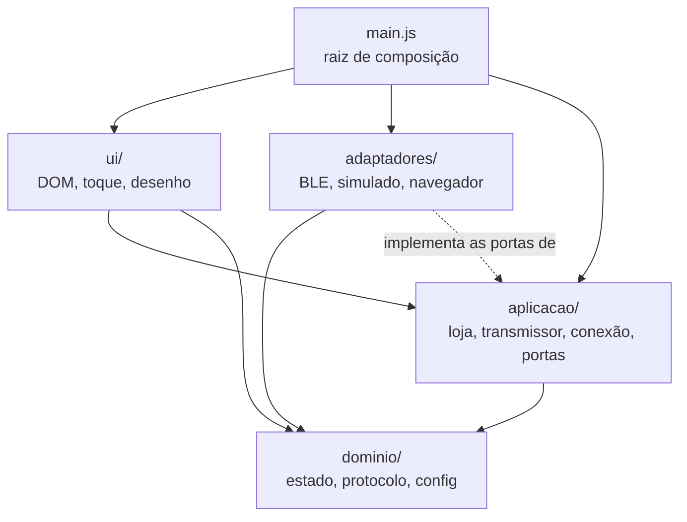
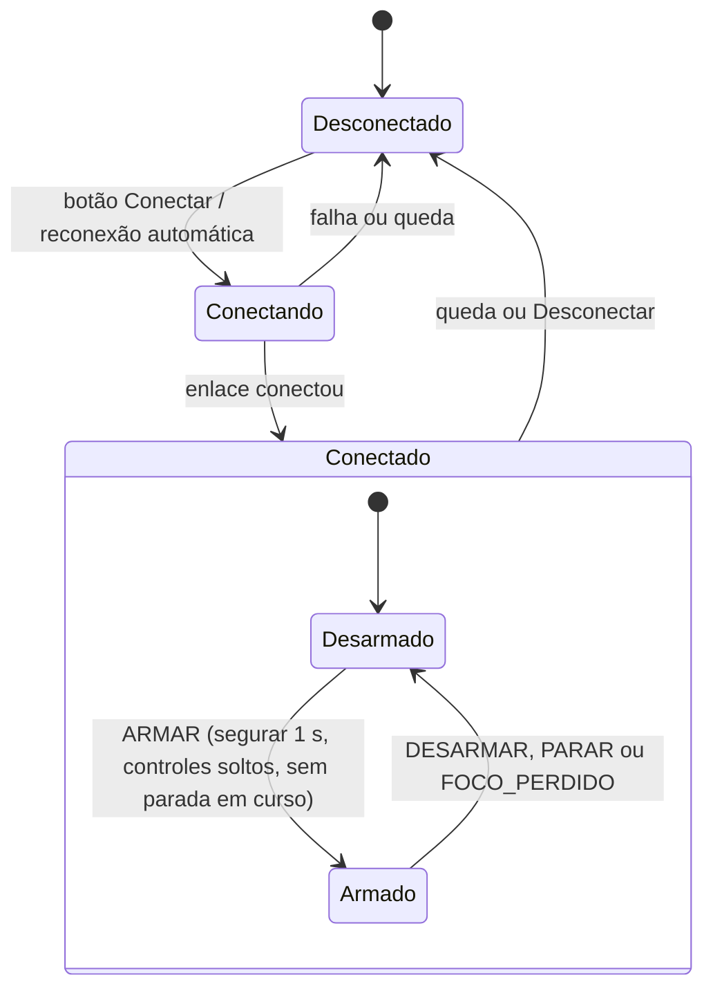

# Arquitetura

## Visão geral

O projeto é um controle remoto web, uma página estática servida pelo GitHub Pages. Ele envia a posição de pitch e roll, em um byte por mensagem, por Web Bluetooth (BLE) para um módulo BLE com UART transparente (tipo HM-10) ligado à controladora, que roda em um silício RISC-V próprio. O protótipo fica preso em bancada, não voa, e o objetivo é validar a resposta do PID. Não há yaw, throttle nem telemetria. No iPhone a página roda no Bluefy (o Safari não tem Web Bluetooth); em Android e PC, no Chrome ou no Edge. Quando a segurança e a conveniência entram em conflito, vale a segurança.

O código segue a arquitetura hexagonal (portas e adaptadores): as regras ficam no centro e não conhecem o navegador nem o rádio. Não há build nem dependências: o navegador carrega os módulos ES direto. Para saber por que cada escolha foi feita, veja os [ADRs](adr/README.md). O formato dos bytes está em [PROTOCOLO.md](../PROTOCOLO.md).

## Camadas

A regra de dependência aponta para dentro: `ui` e `adaptadores` dependem de `aplicacao`, e `aplicacao` depende de `dominio`. O domínio não importa nada de fora dele. Só `src/main.js` conhece todas as camadas e liga as peças. Os adaptadores implementam as portas declaradas em `aplicacao/portas.js`; hoje nenhum importa código da aplicação, só os tipos JSDoc. O mesmo vale para `ui/interface.js`: loja, gerenciador e transmissor chegam por injeção a partir de `main.js`.

## Mapa de arquivos

| Arquivo | Responsabilidade | Pode depender de |
| --- | --- | --- |
| `src/main.js` | Cria adaptadores, loja, gerenciador e transmissor; monta a interface. | todas as camadas |
| `src/dominio/estado.js` | Ações, redutor puro, `podeArmar` e `comandoDeSaida`. | `config.js` |
| `src/dominio/protocolo.js` | Protocolo de um byte: `codificarComando`, `codificarPosicao`, `decodificarByte`, `paraHex`. | nada |
| `src/dominio/config.js` | Valores padrão, faixas e normalização da configuração. | nada |
| `src/aplicacao/portas.js` | Typedefs JSDoc de `Enlace`, `OpcoesDeConexao` e `Armazenamento`. | nada (só tipos) |
| `src/aplicacao/loja.js` | Guarda o estado, despacha ações em fila e avisa os assinantes. | nada |
| `src/aplicacao/transmissor.js` | Laço de envio periódico (heartbeat) com a porta `Enlace`. | `dominio/` |
| `src/aplicacao/conexao.js` | Conectar, desconectar e reconexão automática. Bytes recebidos do módulo são ignorados. | `dominio/`, `portas.js` |
| `src/adaptadores/ble-web.js` | `Enlace` sobre `navigator.bluetooth`. | nada do projeto |
| `src/adaptadores/enlace-simulado.js` | `Enlace` falso (`?simular`): aceita os bytes e guarda a última mensagem decodificada. | `dominio/protocolo.js` |
| `src/adaptadores/navegador.js` | Ciclo de vida da página, wake lock e `localStorage`. | nada do projeto |
| `src/ui/controles.js` | Joystick (pitch e roll, volta ao centro) e botão de segurar. Só conhecem o DOM. | nada do projeto |
| `src/ui/interface.js` | Liga o DOM à loja: despacha ações e desenha o estado. Recebe loja, gerenciador e transmissor por injeção. | `dominio/`, `controles.js`, tipos de `aplicacao/` |
| `firmware/rc_byte.h`, `.c` | Decodificador de byte e receptor (ignora posição antes de conectar, failsafe por timeout) para a controladora. | só `<stdint.h>` e `<stdbool.h>` |

## Fluxo de estado

O estado é unidirecional: ação, redutor puro, loja, assinantes. Ninguém altera o estado diretamente.

Além das transições do diagrama, qualquer saída do estado `Conectado` desarma (ação `CONEXAO_ALTERADA`). `PARAR` vale em qualquer estado, inclusive desconectado. Reconectar nunca rearma: o usuário precisa armar de novo. Com o protótipo armado, a página recusa alterar ajustes e desconectar.

## Configuração

`dominio/config.js` define os valores padrão e as faixas aceitas, e `normalizarConfig` devolve sempre uma configuração válida: campo ausente volta ao padrão e número fora da faixa é saturado. Os campos são os UUIDs do serviço e da característica (padrão HM-10, `FFE0`/`FFE1`), mostrar todos os dispositivos, taxa de envio (10 a 50 Hz, padrão 30) e inverter pitch e roll. A configuração fica no `localStorage` por meio da porta `Armazenamento`; se o navegador bloquear o armazenamento, a página usa os padrões.

## O caminho de um comando

1. O dedo mexe no joystick de `ui/controles.js`, que chama `aoMudar(x, y)` com valores normalizados (-1 a 1; `y` positivo é para cima).
2. `ui/interface.js` despacha `EIXOS_ALTERADOS` com `roll: x` e `pitch: y`. A loja aplica `reduzir` e guarda os eixos saturados.
3. A cada tick do `transmissor` (30 Hz por padrão, configurável de 10 a 50), ele lê o estado atual e chama `comandoDeSaida(estado)`. Esse é o único ponto que decide o que vai para o rádio: desarmado ou em parada, `DESCONECTAR` (`0x00`); logo após armar, `CONECTAR` (`0xFF`) três vezes; depois, a posição, com as inversões da configuração.
4. `codificarComando(comando)` converte para um byte: `nivelDoEixo` arredonda cada eixo para -7 a +7 e `codificarPosicao` monta os nibbles (centro 8; o canto +7/+7, que daria `0xFF`, vira `0xEE`). Um tipo desconhecido vira `0x00`.
5. `enlace.escrever(bytes)` entrega ao adaptador (BLE ou simulado). O byte é montado no instante do envio; nada fica guardado esperando.
6. Se a escrita deu certo, o transmissor despacha `PACOTE_ENVIADO`. Depois de um `PARAR`, isso consome o contador de 10 `0x00` (`PACOTES_DE_PARADA`); depois de armar, o de 3 `0xFF` (`PACOTES_DE_INICIO`).

## Sem telemetria

O protocolo atual só vai da página para a controladora. O caminho de telemetria (decodificador de fluxo, `TELEMETRIA_RECEBIDA`, desarme por failsafe informado pelo firmware) foi removido junto com o pacote de 15 bytes ([ADR 0008](adr/0008-protocolo-de-um-byte.md)). A porta `Enlace` ainda tem `aoReceber` e o adaptador BLE ainda liga as notificações quando a característica as oferece, mas `conexao.js` ignora o que chega e nada na aplicação usa `aoReceber`. Se um dia houver retorno do firmware, é por aí que ele entra.

## Modelo de segurança

São barreiras em camadas. A página é a primeira; o firmware é a última e não confia na página. A justificativa está no [ADR 0006](adr/0006-modelo-de-seguranca.md).

Na página:

1. **Redutor puro** (`dominio/estado.js`): `podeArmar` só deixa armar conectado, sem parada em curso e com o joystick solto. Desarmar, `PARAR`, perda de foco e queda da conexão zeram os eixos e desarmam.
2. **Ponto único de saída** (`dominio/estado.js`, `comandoDeSaida`): se não está armado ou está em parada, sai `0x00`, não importa o que o joystick diga. Ao armar, saem três `0xFF` antes de qualquer posição.
3. **Transmissor sem fila e com envio imediato ao desarmar** (`aplicacao/transmissor.js`): só há uma escrita em andamento; ticks que chegam com ela pendente são descartados. Ao desarmar, o `0x00` sai logo, ou logo após a escrita pendente, e sempre depois de qualquer posição antiga.
4. **Watchdog de escrita** (`aplicacao/transmissor.js`): se uma escrita passa de 1 s (`LIMITE_ESCRITA_MS`), o enlace é desconectado e o failsafe do firmware assume.
5. **Joystick relativo ao ponto de toque** (`ui/controles.js`): encostar o dedo nunca gera valor, só o deslocamento.
6. **Segurar para armar** (`ui/controles.js` e `ui/interface.js`): armar exige manter o botão pressionado por 1 s. Armado, um toque desarma. Além do botão PARAR, as teclas Esc e Espaço também disparam `PARAR`.
7. **Perda de foco** (`adaptadores/navegador.js`): página oculta, suspensa, fechada ou sem foco despacha `FOCO_PERDIDO`, porque no iOS não há execução em segundo plano.

No firmware (`firmware/rc_byte.c`, referência; o firmware real é do colega):

1. **Posição antes de conectar é ignorada.** O receptor começa desconectado e só aceita posições depois de um `0xFF`.
2. **`0x00` sempre vale:** desconecta e zera, em qualquer estado.
3. **Failsafe por timeout:** sem byte aceito por `RC_TIMEOUT_MS` (250 ms), `rc_receptor_tick` desconecta e zera, e posições são ignoradas até um novo `0xFF`. O chamador precisa invocar `rc_receptor_tick` periodicamente.
4. **Não há bytes reservados:** `0x01` a `0xFE` são sempre posição. O texto ASCII do HM-10 cai nessa faixa, por isso se recomenda desligar as notificações do módulo (`AT+NOTI0`).
5. **Limite de setpoint:** os graus por nível são definidos pelo firmware, que deve limitá-los a um valor seguro. A página só envia níveis de -7 a +7; o firmware aceita de -8 a +7.

Não há checksum. Um byte corrompido vira, no pior caso, uma posição errada por um ciclo. O HM-10 pode escrever texto (`OK+CONN`) na UART, que cai na faixa de posição; ver o cuidado em [PROTOCOLO.md](../PROTOCOLO.md), seção 5.4.

## Como estender

### 1. Novo transporte (por exemplo, Web Serial)

Caso típico: manter o HC-05 (Bluetooth Classic), que não funciona com Web Bluetooth. Web Serial roda no Chrome desktop e no Android, mas não no iPhone.

1. Crie `src/adaptadores/serial-web.js` com uma função `criarEnlaceSerial()` que devolva um objeto no formato de `Enlace` (veja `aplicacao/portas.js`): `suportado`, `conectar`, `reconectar`, `desconectar`, `escrever`, `aoReceber` e `aoDesconectar`.
2. Respeite o contrato: `escrever` resolve quando o transporte aceitou os bytes e não será chamada de novo antes disso; `aoDesconectar` deve ser chamado em toda queda, inclusive a que o navegador detecta sozinho; `conectar` abre o seletor e só é chamada a partir de um gesto do usuário.
3. `aoReceber` pode ficar vazio: hoje ninguém o usa.
4. Em `src/main.js`, escolha o adaptador onde hoje se escolhe entre `criarEnlaceBle()` e `criarEnlaceSimulado()`. Nenhum outro arquivo muda.
5. Se o transporte precisar de opções novas (por exemplo, baud rate), acrescente-as a `OpcoesDeConexao` e a `config.js`.
6. Teste o adaptador injetando um objeto falso do navegador, como já é feito com `bluetooth` em `criarEnlaceBle`.

### 2. Mudar o protocolo

O protocolo existe em duas implementações que precisam ficar iguais.

1. Atualize primeiro `PROTOCOLO.md`: bytes, significado e regras do receptor. Não há bytes livres para extensões (ver o [ADR 0009](adr/0009-bytes-especiais-e-centro-do-firmware.md)).
2. JavaScript, em `src/dominio/protocolo.js`: constantes, `Tipo`, `codificarComando` e `decodificarByte`. Se há um tipo novo de comando, ajuste `Comando` e `comandoDeSaida` em `estado.js`, mantendo `0x00` como saída quando desarmado.
3. C, em `firmware/rc_byte.h` e `.c`: `rc_decodificar`, `rc_codificar_posicao` e a regra de segurança em `rc_receptor_processar`.
4. Atualize os testes: os de JavaScript com `node --test` e o de C em `testes/firmware/teste_byte.c`. O teste cruzado compara os 256 valores de byte nos dois lados.
5. Mudou o protocolo de forma incompatível? Registre um ADR novo que substitua o 0008.

### 3. Novo controle na interface

1. Novo eixo ou valor de estado (hoje só há pitch e roll): acrescente o campo em `Eixos` e em `EIXOS_ZERADOS` (`dominio/estado.js`) e a saturação dele em `EIXOS_ALTERADOS`. Se o controle gera uma ação nova, acrescente-a a `Acao` e um `case` no redutor.
2. Regra de segurança: decida no redutor se o novo valor desarma ou bloqueia o armar (ajuste `podeArmar` se preciso). Nunca decida isso na UI.
3. Saída: se o valor deve ir para o rádio, inclua-o em `comandoDeSaida`, que continua sendo o único ponto de saída, e então siga o roteiro do caso 2 (o byte de posição só tem dois nibbles; um terceiro eixo pede um protocolo novo).
4. Componente de toque: use ou acrescente uma função em `ui/controles.js` (o `criarJoystick` devolve ao centro ao soltar). Ela só conhece o DOM, deve ser relativa ao ponto de toque e deve expor `reiniciar()`, que `interface.js` chama quando `geracaoDeControles` muda.
5. Em `index.html` e `css/`, acrescente o elemento; em `ui/interface.js`, despache a ação e desenhe o novo valor em `desenhar()`.
6. Teste o redutor e `comandoDeSaida` com `node --test`, sem navegador.

## Convenções

- **JavaScript**: Google JavaScript Style Guide (módulos ES, `const` e `let`, camelCase, CONSTANTE_EM_MAIUSCULAS, arquivos em kebab-case, 2 espaços, ponto e vírgula, aspas simples) com tipos em JSDoc. Identificadores em português sem acento; comentários e documentação em português.
- **C**: C99, só `<stdint.h>` e `<stdbool.h>`, tipos de largura fixa, sem alocação dinâmica, prefixo `rc_` em tudo que é público. Deve compilar com `-std=c99 -Wall -Wextra -Werror -pedantic`.
- **Testes**: `node --test` para o JavaScript e `gcc` para o C. Não há build.
- **Commits**: Conventional Commits (`feat:`, `fix:`, `docs:`, `test:` e assim por diante).
- **Decisões**: cada decisão de arquitetura vira um ADR. Veja o [índice dos ADRs](adr/README.md) e o [ADR 0007](adr/0007-convencoes-de-codigo.md).
