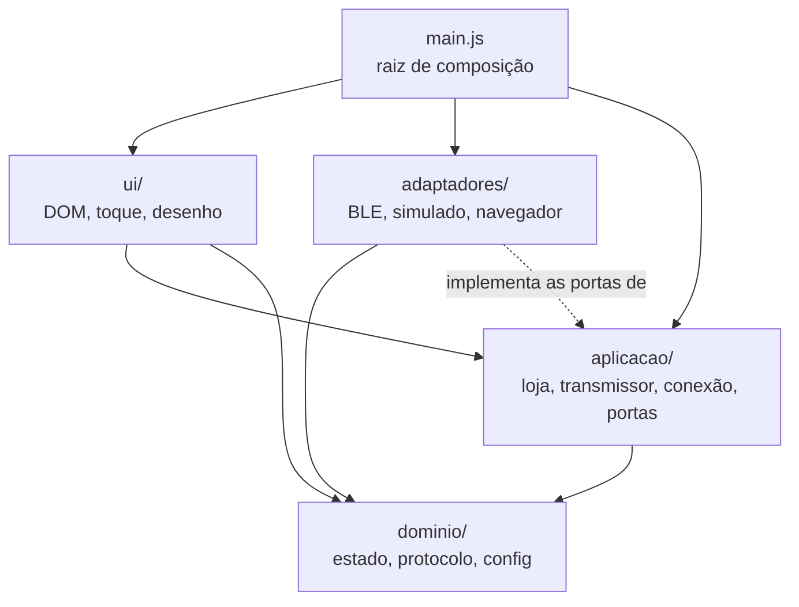
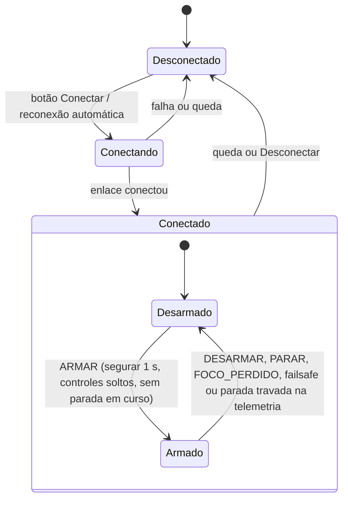

# Arquitetura

## Visão geral

O projeto é um controle remoto web, uma página estática servida pelo GitHub Pages. Ele envia setpoints de roll, pitch, yaw e throttle por Web Bluetooth (BLE) para um módulo UART transparente (tipo HM-10) ligado à controladora de voo, que roda em um silício RISC-V próprio. O protótipo fica preso em bancada e o objetivo é validar a resposta do PID. No iPhone a página roda no Bluefy (o Safari não tem Web Bluetooth); em Android e PC, no Chrome ou no Edge. Quando a segurança e a conveniência entram em conflito, vale a segurança.

O código segue a arquitetura hexagonal (portas e adaptadores): as regras ficam no centro e não conhecem o navegador nem o rádio. Não há build nem dependências: o navegador carrega os módulos ES direto. Para saber por que cada escolha foi feita, veja os [ADRs](adr/README.md). O formato dos bytes está em [PROTOCOLO.md](../PROTOCOLO.md).

## Camadas

A regra de dependência aponta para dentro: `ui` e `adaptadores` dependem de `aplicacao`, e `aplicacao` depende de `dominio`. O domínio não importa nada de fora dele. Só `src/main.js` conhece todas as camadas e liga as peças. Os adaptadores implementam as portas declaradas em `aplicacao/portas.js`; hoje nenhum importa código da aplicação, só os tipos JSDoc. O mesmo vale para `ui/interface.js`: loja, gerenciador e transmissor chegam por injeção a partir de `main.js`.

## Mapa de arquivos

| Arquivo | Responsabilidade | Pode depender de |
| --- | --- | --- |
| `src/main.js` | Cria adaptadores, loja, gerenciador e transmissor; monta a interface. | todas as camadas |
| `src/dominio/estado.js` | Ações, redutor puro, `podeArmar` e `comandoDeSaida`. | `config.js` |
| `src/dominio/protocolo.js` | Quadro de 15 bytes, CRC-16, `codificarComando`, decodificador de fluxo. | nada |
| `src/dominio/config.js` | Valores padrão, faixas e normalização da configuração. | nada |
| `src/aplicacao/portas.js` | Typedefs JSDoc de `Enlace`, `OpcoesDeConexao` e `Armazenamento`. | nada (só tipos) |
| `src/aplicacao/loja.js` | Guarda o estado, despacha ações em fila e avisa os assinantes. | nada |
| `src/aplicacao/transmissor.js` | Laço de envio periódico (heartbeat) com a porta `Enlace`. | `dominio/` |
| `src/aplicacao/conexao.js` | Conectar, desconectar, reconexão automática e leitura da telemetria. | `dominio/`, `portas.js` |
| `src/adaptadores/ble-web.js` | `Enlace` sobre `navigator.bluetooth`. | nada do projeto |
| `src/adaptadores/enlace-simulado.js` | `Enlace` falso (`?simular`): aceita comandos e devolve telemetria. | `dominio/protocolo.js` |
| `src/adaptadores/navegador.js` | Ciclo de vida da página, wake lock e `localStorage`. | nada do projeto |
| `src/ui/controles.js` | Joystick de dois eixos e botão de segurar. Só conhecem o DOM. | nada do projeto |
| `src/ui/interface.js` | Liga o DOM à loja: despacha ações e desenha o estado. Recebe loja, gerenciador e transmissor por injeção. | `dominio/`, `controles.js`, tipos de `aplicacao/` |
| `firmware/rc_protocolo.h`, `.c` | Parser, CRC e regras de segurança do lado da controladora. | só `<stdint.h>` e `<stdbool.h>` |

## Fluxo de estado

O estado é unidirecional: ação, redutor puro, loja, assinantes. Ninguém altera o estado diretamente.

Além das transições do diagrama, qualquer saída do estado `Conectado` desarma (ação `CONEXAO_ALTERADA`). `PARAR` vale em qualquer estado, inclusive desconectado. Reconectar nunca rearma: o usuário precisa armar de novo. Com o protótipo armado, a página recusa alterar ajustes e desconectar.

## Configuração

`dominio/config.js` define os valores padrão e as faixas aceitas, e `normalizarConfig` devolve sempre uma configuração válida: campo ausente volta ao padrão e número fora da faixa é saturado. Os padrões são conservadores (roll e pitch até 15 graus, yaw em taxa até 45 graus/s, throttle até 30%, 30 Hz). A configuração fica no `localStorage` por meio da porta `Armazenamento`; se o navegador bloquear o armazenamento, a página usa os padrões.

## O caminho de um comando

1. O dedo mexe em um controle de `ui/controles.js`, que chama `aoMudar` com um valor normalizado (-1 a 1, ou 0 a 1 no throttle).
2. `ui/interface.js` despacha `EIXOS_ALTERADOS`. A loja aplica `reduzir` e guarda os eixos saturados.
3. A cada tick do `transmissor` (30 Hz por padrão, configurável de 5 a 50), ele lê o estado atual e chama `comandoDeSaida(estado)`. Esse é o único ponto que decide o que vai para o rádio: desarmado ou em parada, tudo sai zerado; armado, aplica ângulo máximo, inversões, modo do yaw e teto de throttle da configuração.
4. `codificarComando(comando, seq)` converte para as unidades do protocolo e monta os 15 bytes com CRC. Ele zera os valores de novo se o comando for desarmado ou de parada.
5. `enlace.escrever(bytes)` entrega ao adaptador (BLE ou simulado). O pacote é montado no instante do envio; nada fica guardado esperando.
6. Se a escrita deu certo, o transmissor despacha `PACOTE_ENVIADO`. Depois de um `PARAR`, isso consome o contador de 10 pacotes seguidos com a flag de parada (`PACOTES_DE_PARADA`).

## O caminho da telemetria

1. O módulo notifica bytes; o adaptador chama quem registrou `enlace.aoReceber`.
2. `aplicacao/conexao.js` passa os bytes ao decodificador de fluxo de `protocolo.js`, que ressincroniza depois de lixo e descarta pacotes com CRC inválido.
3. Para cada pacote de telemetria, o gerenciador converte para unidades físicas e despacha `TELEMETRIA_RECEBIDA`.
4. O redutor guarda a telemetria. Se a página está armada e o firmware informa failsafe ou parada travada, o redutor desarma.
5. `ui/interface.js` desenha os valores medidos. Telemetria com mais de 1 s aparece como "sem telemetria".

## Modelo de segurança

São barreiras em camadas. A página é a primeira; o firmware é a última e não confia na página. A justificativa está no [ADR 0006](adr/0006-modelo-de-seguranca.md).

Na página:

1. **Redutor puro** (`dominio/estado.js`): `podeArmar` só deixa armar conectado, sem parada em curso e com todos os eixos em zero. Desarmar, `PARAR`, perda de foco, queda da conexão e telemetria de failsafe zeram os eixos e desarmam.
2. **Ponto único de saída** (`dominio/estado.js`, `comandoDeSaida`): se não está armado, tudo sai zerado, não importa o que os controles digam.
3. **Segunda barreira** (`dominio/protocolo.js`, `codificarComando`): comando desarmado ou de parada sempre sai com roll, pitch, yaw e throttle em zero, mesmo que quem chama erre.
4. **Transmissor sem fila e com envio imediato ao desarmar** (`aplicacao/transmissor.js`): só há uma escrita em andamento; ticks que chegam com ela pendente são descartados. Ao desarmar, o pacote zerado sai logo, ou logo após a escrita pendente, e sempre depois de qualquer valor antigo.
5. **Watchdog de escrita** (`aplicacao/transmissor.js`): se uma escrita passa de 1 s (`LIMITE_ESCRITA_MS`), o enlace é desconectado e o failsafe do firmware assume.
6. **Controles relativos ao ponto de toque** (`ui/controles.js`): encostar o dedo nunca gera valor, só o deslocamento. O eixo do throttle (vertical do joystick esquerdo) fica travado enquanto desarmado.
7. **Segurar para armar** (`ui/controles.js` e `ui/interface.js`): armar exige manter o botão pressionado por 1 s. Armado, um toque desarma. Além do botão PARAR, as teclas Esc e Espaço também disparam `PARAR`.
8. **Perda de foco** (`adaptadores/navegador.js`): página oculta, suspensa, fechada ou sem foco despacha `FOCO_PERDIDO`, porque no iOS não há execução em segundo plano.

No firmware (`firmware/rc_protocolo.c`):

1. **Trava de parada**: o receptor começa travado. Um pacote de parada zera tudo e trava; um pacote armado é rejeitado enquanto a trava estiver ativa. A trava só sai com um pacote desarmado e zerado.
2. **Armar só com zeros**: um pacote armado com algum valor diferente de zero é rejeitado se o receptor ainda está desarmado.
3. **Limites**: roll e pitch saturam em `RC_LIMITE_ROLL_PITCH` (30,00 graus), yaw em `RC_LIMITE_YAW` e throttle em `RC_LIMITE_THROTTLE`. São macros que podem ser trocadas na linha de compilação.
4. **Sequência**: pacote armado repetido ou mais antigo que o último aceito é rejeitado.
5. **Failsafe por timeout**: sem comando válido por `RC_TIMEOUT_MS` (250 ms), `rc_receptor_tick` zera, desarma e trava. O chamador precisa invocar `rc_receptor_tick` periodicamente.

Além disso, o receptor rejeita tipo desconhecido, flags fora de `RC_FLAGS_DE_COMANDO` e pacote desarmado com valores.

## Como estender

### 1. Novo transporte (por exemplo, Web Serial)

1. Crie `src/adaptadores/serial-web.js` com uma função `criarEnlaceSerial()` que devolva um objeto no formato de `Enlace` (veja `aplicacao/portas.js`): `suportado`, `conectar`, `reconectar`, `desconectar`, `escrever`, `aoReceber` e `aoDesconectar`.
2. Respeite o contrato: `escrever` resolve quando o transporte aceitou os bytes e não será chamada de novo antes disso; `aoDesconectar` deve ser chamado em toda queda, inclusive a que o navegador detecta sozinho; `conectar` abre o seletor e só é chamada a partir de um gesto do usuário.
3. Entregue os bytes recebidos em `aoReceber` como vierem. O decodificador de fluxo já trata pedaços de qualquer tamanho.
4. Em `src/main.js`, escolha o adaptador onde hoje se escolhe entre `criarEnlaceBle()` e `criarEnlaceSimulado()`. Nenhum outro arquivo muda.
5. Se o transporte precisar de opções novas (por exemplo, baud rate), acrescente-as a `OpcoesDeConexao` e a `config.js`.
6. Teste o adaptador injetando um objeto falso do navegador, como já é feito com `bluetooth` em `criarEnlaceBle`.

### 2. Novo campo ou novo tipo de pacote

O protocolo existe em duas implementações que precisam ficar iguais.

1. Atualize primeiro `PROTOCOLO.md`: layout, tamanho, unidades e a regra de validação. Mantenha o pacote dentro de 20 bytes se quiser caber no MTU padrão do BLE.
2. JavaScript, em `src/dominio/protocolo.js`: constantes (`TAMANHO_PACOTE`, tipo, flag), `codificarPacote`, `decodificarPacote` e o intervalo coberto pelo `crc16`. Se o campo vem do comando, ajuste `Comando` e `codificarComando`, mantendo o zero obrigatório quando desarmado.
3. C, em `firmware/rc_protocolo.h` e `.c`: as macros, `rc_pacote_t`, `rc_parser_alimentar`, `rc_codificar` e a regra de segurança em `rc_receptor_processar`. Um campo novo no comando também precisa de limite e de tratamento no armar.
4. Para um tipo novo de pacote, `rc_receptor_processar` hoje rejeita tudo que não é `RC_TIPO_COMANDO`, e `conexao.js` ignora tudo que não é telemetria. Trate o tipo novo nos dois lados.
5. Atualize os testes: os de `src/dominio/protocolo.js` com `node --test`, e os do firmware em `testes/firmware/` com `gcc`. Confira que os dois lados produzem os mesmos bytes para o mesmo comando.
6. Mudou o layout de forma incompatível? Registre um ADR novo que substitua o 0005.

### 3. Novo controle na interface

1. Novo eixo ou valor de estado: acrescente o campo em `Eixos` e em `EIXOS_ZERADOS` (`dominio/estado.js`) e a saturação dele em `EIXOS_ALTERADOS`. Se o controle gera uma ação nova, acrescente-a a `Acao` e um `case` no redutor.
2. Regra de segurança: decida no redutor se o novo valor desarma ou bloqueia o armar (ajuste `podeArmar` se preciso). Nunca decida isso na UI.
3. Saída: se o valor deve ir para o rádio, inclua-o em `comandoDeSaida`, que continua sendo o único ponto de saída, e então siga o roteiro do caso 2.
4. Componente de toque: use ou acrescente uma função em `ui/controles.js` (o `criarJoystick` já aceita um eixo vertical que não volta ao soltar, como o throttle). Ela só conhece o DOM, deve ser relativa ao ponto de toque e deve expor `reiniciar()`, que `interface.js` chama quando `geracaoDeControles` muda.
5. Em `index.html` e `css/`, acrescente o elemento; em `ui/interface.js`, despache a ação e desenhe o novo valor em `desenhar()`.
6. Teste o redutor e `comandoDeSaida` com `node --test`, sem navegador.

## Convenções

- **JavaScript**: Google JavaScript Style Guide (módulos ES, `const` e `let`, camelCase, CONSTANTE_EM_MAIUSCULAS, arquivos em kebab-case, 2 espaços, ponto e vírgula, aspas simples) com tipos em JSDoc. Identificadores em português sem acento; comentários e documentação em português.
- **C**: C99, só `<stdint.h>` e `<stdbool.h>`, tipos de largura fixa, sem alocação dinâmica, prefixo `rc_` em tudo que é público. Deve compilar com `-std=c99 -Wall -Wextra -Werror -pedantic`.
- **Testes**: `node --test` para o JavaScript e `gcc` para o C. Não há build.
- **Commits**: Conventional Commits (`feat:`, `fix:`, `docs:`, `test:` e assim por diante).
- **Decisões**: cada decisão de arquitetura vira um ADR. Veja o [índice dos ADRs](adr/README.md) e o [ADR 0007](adr/0007-convencoes-de-codigo.md).
